# CMMS_Eaton

A maintenance management web app (CMMS) for the plant: dashboard, breakdown work orders, preventive
maintenance with scheduling, other work orders, assets, spare parts and user management with role-based
access for technicians, production supervisors, the maintenance supervisor and the owner.

It is a static web app (React + TypeScript, installable as a PWA) that runs entirely in the browser, so it
can be published on [AweShell](https://aweshell.ai/en) static hosting with no server. The plant data is one
document that lives, per device, in the browser, in a shared folder (the OneDrive-synced SharePoint
library) or, in a later release, directly in SharePoint online through Microsoft Graph.

> **Sample data.** The first start seeds a sample plant. Employee IDs starting with `D-` and the plant
> name "(sample plant)" are made up. Replace them before going live (Settings → Backup & export → Start fresh).

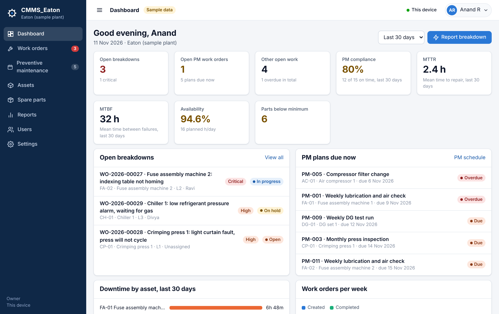

## Features

| Module | What it does |
|---|---|
| Dashboard | Open breakdowns, open PM and other work, PM compliance, MTTR, MTBF, availability, parts below minimum, downtime by asset, work orders per week, PM plans due, recent activity. Role-aware: technicians see their own work first, production supervisors see their lines and the handback queue. |
| Breakdown work orders | Report in seconds (machine, title, stop time; priority comes from asset criticality, shift from the stop time and the line), start, hold, complete with root cause, failure code, action, downtime and meter reading, production handback, supervisor close, comments, labour, parts, status history. |
| Preventive maintenance | PM plans per asset: calendar interval (days/weeks/months/years), meter interval (hours/cycles) or both; fixed or floating schedule; checklist and planned parts; lead days; automatic work order generation; month calendar; compliance tracking. |
| Other work orders | Corrective, improvement, safety, inspection, project and other, with due dates, estimates, checklists and assignment. |
| Assets | Lines → machines → components, criticality A/B/C, status, specs, meter, QR code per asset and a printable QR sticker sheet, per-asset history, MTTR and MTBF, linked PM plans and parts, CSV import, Excel export. |
| Spare parts | Catalogue with stock, min/max, location, cost, supplier and lead time; receive, issue to a work order, return, count adjustments; full movement history; low-stock alerts; CSV import, Excel export. |
| Reports | Any period: downtime by asset, breakdowns by failure code and by line and shift, work orders by type, PM compliance by month, technician hours, parts consumption; one-click Excel export. |
| Users and access | Employee ID + password sign-in, temporary passwords that must be changed, lockout after five failed attempts, four roles with a fixed permission matrix (below), audit log of every change. |
| Settings | Plant details, shift timings (A and B plant-wide, C only on flagged lines), lines, pick lists, data storage mode, backup and restore, reset. |

### Roles

| Action | Technician | Production supervisor | Maintenance supervisor | Owner |
|---|---|---|---|---|
| Raise breakdown or work request | Yes | Yes | Yes | Yes |
| Assign, prioritise, edit, close or cancel work orders | No | No | Yes | Yes |
| Execute work (start, labour, parts, checklist, complete) | Own or unassigned | No | Yes | Yes |
| Confirm machine handback after a repair | No | Yes | Yes | Yes |
| PM plans and generation | View | View | Full | Full |
| Assets | View, meter | View | Full | Full |
| Spare parts | View, issue, return | View | Full | Full |
| Dashboard and reports | Own work | Own lines | Full | Full |
| Users | No | No | Technicians | Everyone |
| Settings, audit log, storage, reset | No | No | Backup export only | Full |

The matrix is code (`src/lib/permissions.ts`) and tested (`tests/permissions.test.ts`).

### Shifts

Shifts A (06:00–14:00) and B (14:00–22:00) run plant-wide; shift C (22:00–06:00) only on the lines flagged
under Settings → Lines. Breakdowns are stamped with the shift of the stop time, a warning shows when a line
does not normally run that shift, and per-asset MTBF uses the hours of that line's shifts.

## Quick start (local)

Node 22 or newer.

```bash
cd cmms-eaton
npm ci
npm run dev        # http://localhost:5173
npm test           # 31 unit tests: shifts, permissions, PM scheduling, KPIs, work order flow, CSV
npm run build      # type-check + production build into dist/
npm run package    # zips dist/ into release/CMMS_Eaton-<version>.zip
node docs/capture-demo.mjs   # browser walk-through of every role with screenshots (needs Playwright + Chromium)
```

Sample accounts, all with password `demo1234`:

| Employee ID | Role |
|---|---|
| `D-OWNER` | Owner |
| `D-MSUP` | Maintenance supervisor |
| `D-PSUP` | Production supervisor (lines L1, L2) |
| `D-TECH1`, `D-TECH2`, `D-TECH3` | Technicians |

## Publishing on AweShell

AweShell hosts static files and gives the upload its own HTTPS address; no server, database or login
service is involved, which is exactly what this app needs.

1. `npm run build && npm run package` (or download the `CMMS_Eaton-dist` artifact from the GitHub
   Actions run; it holds the same zip).
2. Open the [AweShell console](https://aweshell-console.aweray.com/en/console/file-hosting) → Static
   Hosting → upload `release/CMMS_Eaton-<version>.zip` (drag and drop, or *Select .zip*).
3. Claim the link to your AweRay account so it stays online, and optionally set a custom subdomain
   under *Custom Domain*.
4. Open the link on each PC or phone, sign in, and use *Add to Home screen* / *Install* to get the app icon.

To update, upload the new zip to the same resource; the address does not change. The AweShell CLI
(`npm install -g @aweray/aweshell-cli`) can do the same upload from a terminal or an AI agent.

The bundle expects to live at the root of its domain (AweShell's default). It uses hash routing, so deep
links and QR codes work without any server-side rewrite rules.

## Where the data lives

The whole database is one JSON document, `CMMS_Eaton-data.json`. Each device chooses where it keeps it
(Settings → Data storage):

| Mode | Use when | Notes |
|---|---|---|
| **This device** (default) | One PC or phone, trials, demos | Stored in the browser (IndexedDB). Move data with Backup & export. |
| **Shared folder** | Several PCs sharing the Eaton SharePoint library | Sync the library with OneDrive, then choose the synced folder in the app (desktop Edge or Chrome). Everyone with the folder sees the same data; other people's changes are picked up within about 15 seconds. Two saves in the same second can create a OneDrive conflict copy; the newest file wins. |
| **SharePoint online** | Later release | Direct Microsoft Graph connection; the site URL, library path, tenant and app id are already collected in Settings. See [docs/SHAREPOINT.md](docs/SHAREPOINT.md). |

Backups: Settings → Backup & export downloads the JSON (full restore) or an Excel workbook with every table.

Storage is not encrypted (by request: the data stays inside the company SharePoint). Passwords are never
stored in clear; they are hashed with PBKDF2-SHA256 (120,000 iterations, per-user salt). Because the app
has no server, access control is enforced in the browser: it keeps honest people in their lane and keeps
a clear audit trail, but anyone with the data file can read it. Keep the file inside the restricted
SharePoint library.

## Project layout

```
cmms-eaton/
├── index.html, vite.config.ts     static PWA build; CSP without inline scripts
├── public/                        icons
├── scripts/package.mjs            dist → release zip (no dependencies)
├── scripts/icons.mjs              SVG → PNG icons
├── src/
│   ├── types.ts                   domain model (one Snapshot document)
│   ├── lib/                       pure logic: dates & shifts, permissions, work orders, PM scheduling,
│   │                              KPIs, mutations, CSV, Excel export, password hashing
│   ├── store/                     snapshot defaults/migration, storage adapters (device / folder /
│   │                              SharePoint placeholder), React provider, sample data
│   ├── components/                layout, UI kit, charts, forms
│   └── pages/                     dashboard, work orders, PM, assets, parts, users, reports, settings
├── tests/                         vitest unit tests
└── docs/                          SHAREPOINT.md, capture-demo.mjs, screenshots/
```

## Going live checklist

1. Owner: Settings → Backup & export → *Start fresh*, then create the owner account.
2. Settings → Plant, Shifts, Lines (tick C for the lines that run nights), Lists.
3. Assets → *Import CSV* (or add by hand); print the QR sheet.
4. Spare parts → *Import CSV* with opening stock.
5. Preventive maintenance → create plans; *Generate due work orders*.
6. Users → create supervisors and technicians; hand over temporary passwords in person.
7. Settings → Data storage → *Shared folder* on each PC that should share data; phones use *This device*
   until the SharePoint online connection is in place.
8. Publish on AweShell and install the app on each device.

## Screenshots

| | |
|---|---|
| 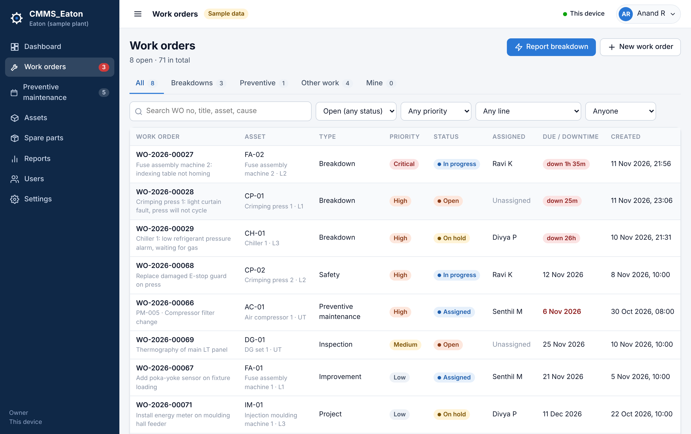 | 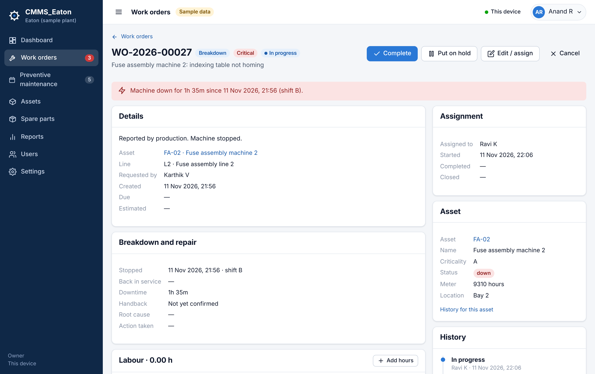 |
| 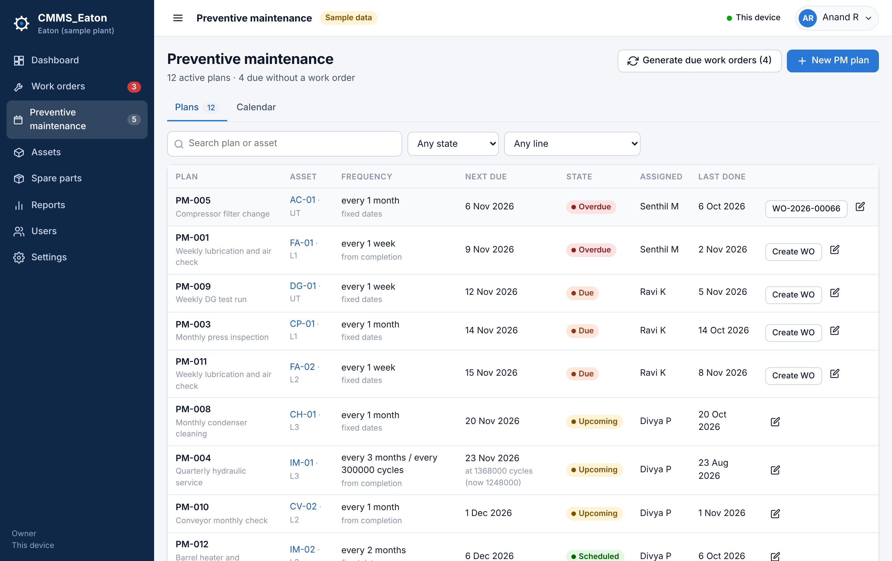 | 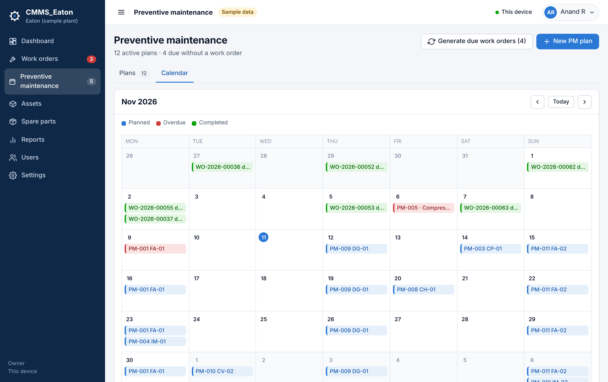 |
| 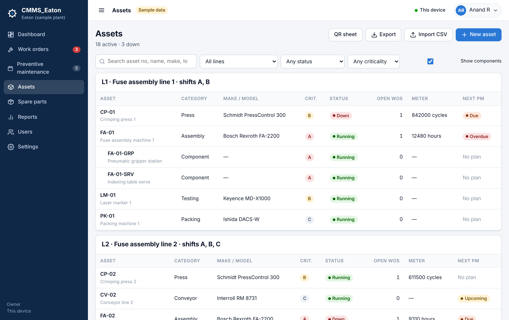 | 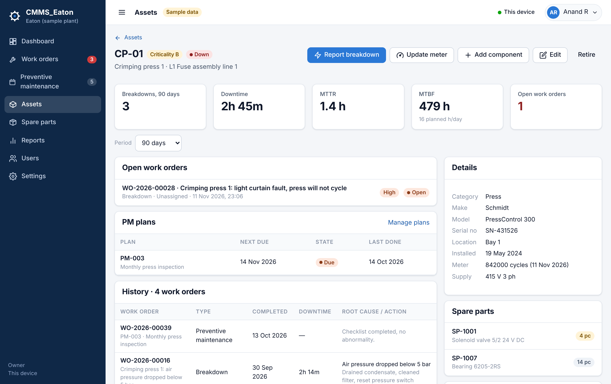 |
| 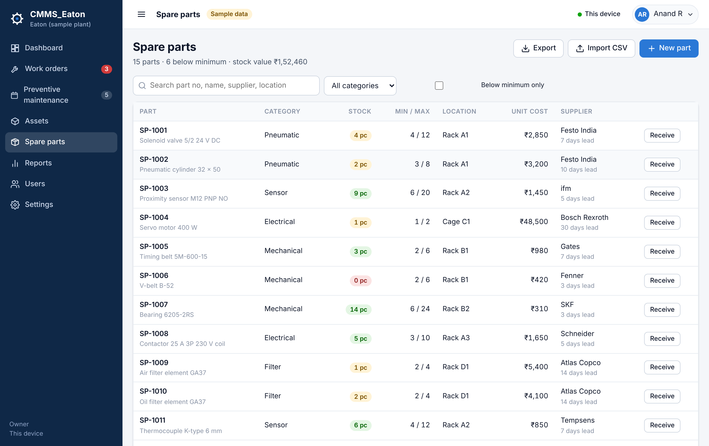 | 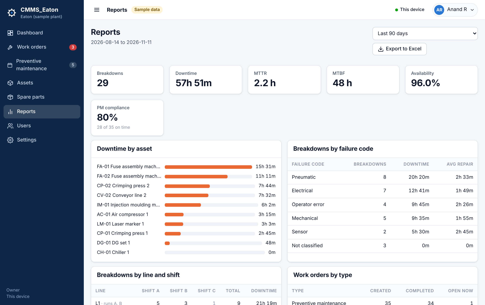 |
| 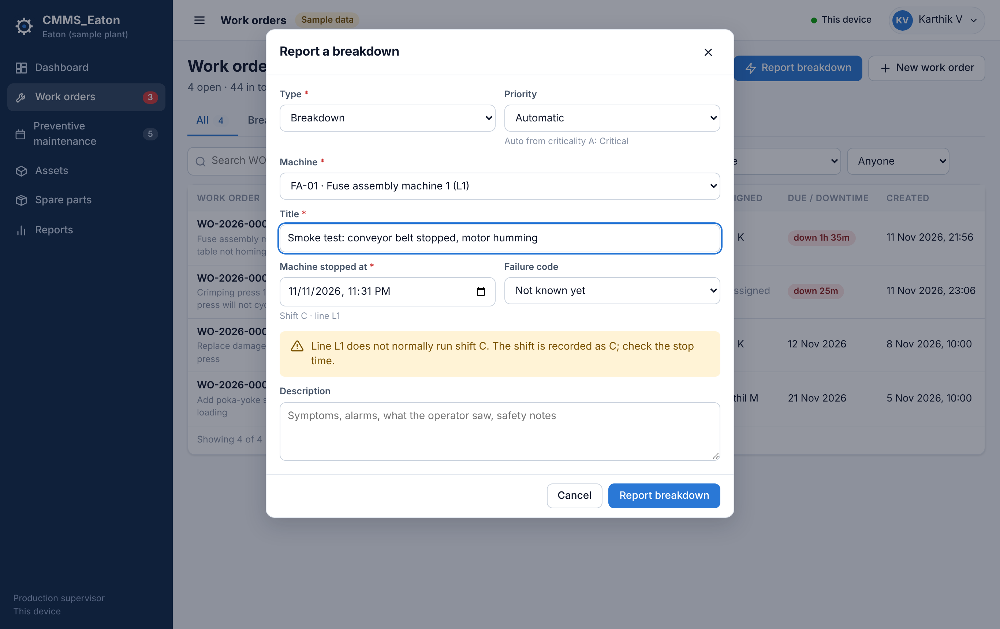 | 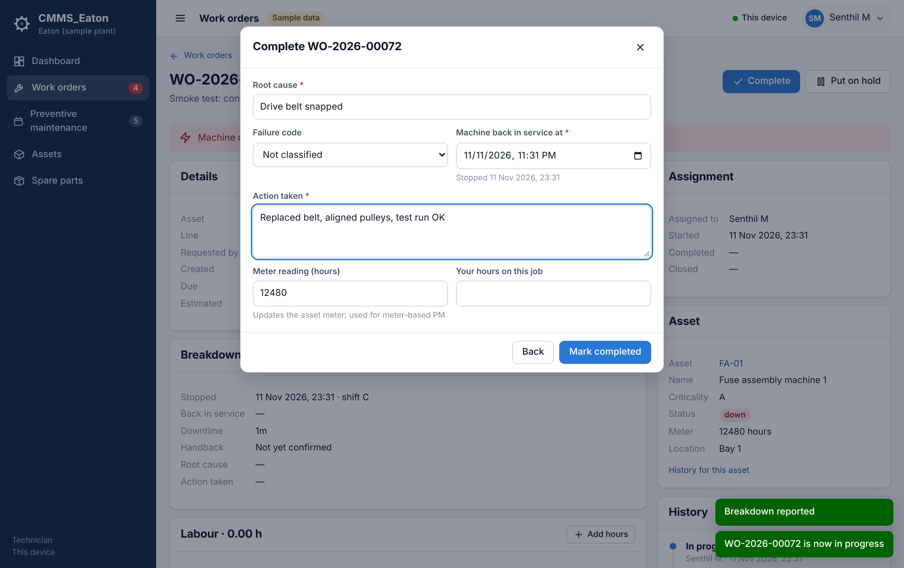 |
| 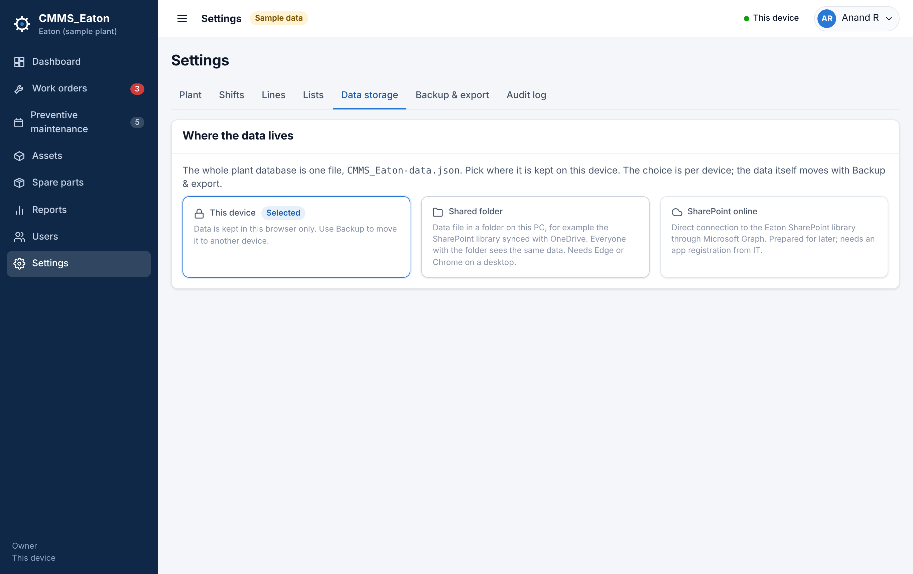 | 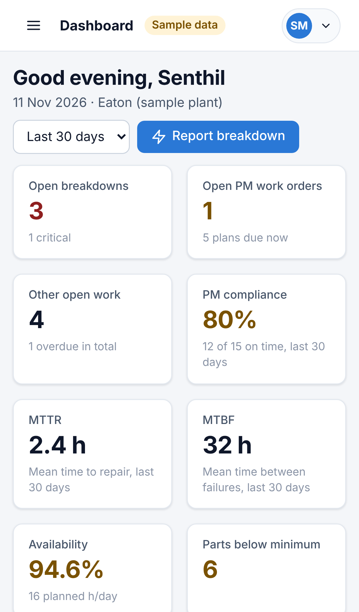 |
