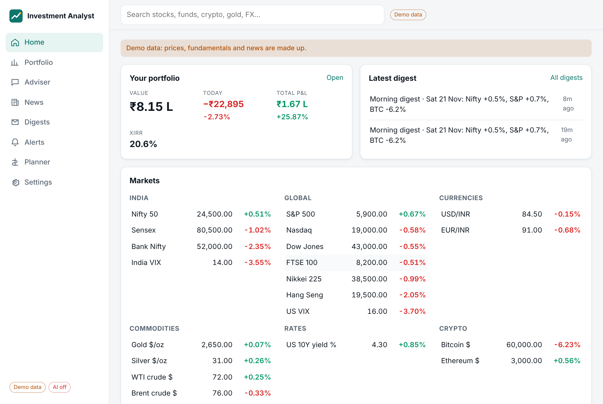
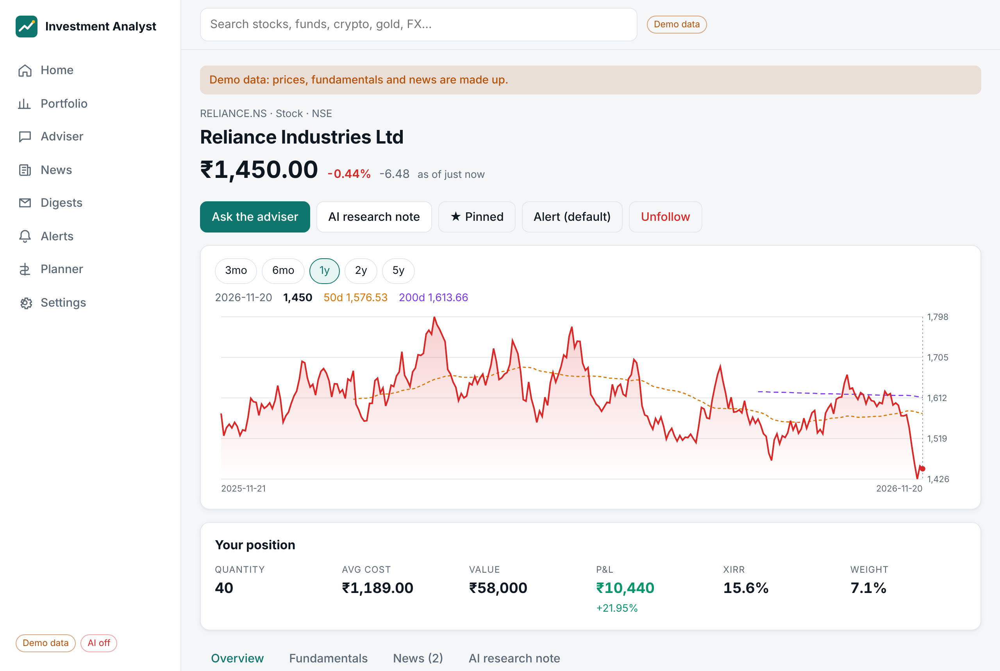
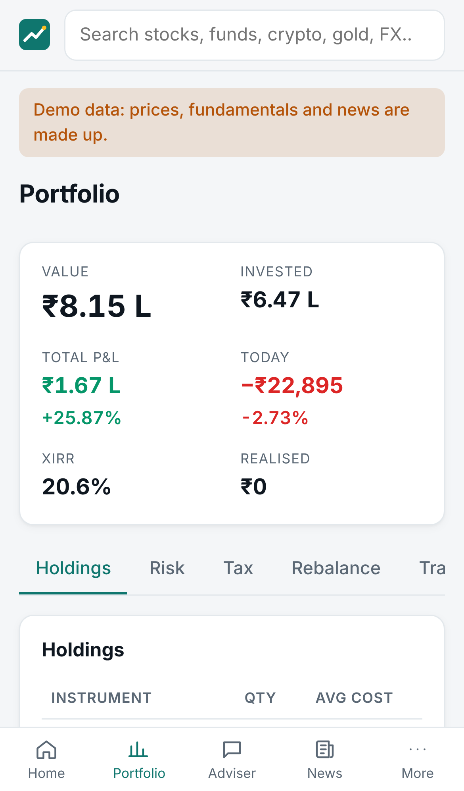

# Investment Analyst

A private investment-analysis app with an AI adviser. It follows every stock, fund, coin, commodity or
currency you search, collects the news on them, and sends you digests and alerts by **email** and
**phone push**. It runs as an installable web app (PWA) for one owner.

> Personal analysis tool. Its views are not advice from a SEBI-registered investment adviser.
> Market data comes from free, unofficial sources and can be delayed or wrong; check before you trade.



## What it does

| Area | Details |
|---|---|
| **Markets** | Indian stocks (NSE/BSE), indices, ETFs, Indian mutual funds (AMFI NAVs), US and global stocks, crypto (Crypto.com), gold, silver, crude, USD/INR and other FX, US yields, macro data (Fed funds, US and India CPI, India 10Y). |
| **AI adviser (chat)** | Claude, using 15 tools: search, full instrument analysis, comparisons, price history, news, market overview, your portfolio, risk, tax, rebalancing, sale-tax estimates, goal and retirement plans, watchlist. Gives direct **Buy / Accumulate / Hold / Reduce / Sell / Avoid** views with confidence, fair-value range, bull and bear cases, risks and position sizing for your profile. |
| **Fundamentals** | Valuation multiples, profitability, growth, balance-sheet health, 0–100 scores, a two-stage DCF (bear/base/bull) or justified P/B–ROE for banks, peer-relative valuation. |
| **Technicals** | 20/50/200-day averages, golden/death crosses, RSI (Wilder), MACD, Bollinger bands, ATR, support and resistance, momentum, volatility, drawdown, a −100…+100 score. |
| **Funds** | 1/3/5-year CAGR, rolling 1- and 3-year returns, Sharpe, Sortino, drawdown, beta and alpha against Nifty 50 or S&P 500. |
| **Portfolio** | Trades (FIFO lots), INR valuation with trade-date FX for foreign assets, P&L, XIRR per holding and overall, allocation against a model for your risk profile, concentration, 1-year risk (volatility, VaR, beta, correlations, risk contribution), rebalancing amounts. Imports Zerodha tradebooks and Zerodha/Groww holdings CSVs. |
| **Indian tax** | FY 2025-26 rules: equity STCG 20% / LTCG 12.5% above ₹1.25 lakh, 12- vs 24-month holding periods by asset type, debt funds bought after 1 Apr 2023 at slab rate, crypto at a flat 30% with no loss set-off, 4% cess. Shows tax if sold today, lots turning long-term soon, LTCG harvesting room and tax-loss candidates. |
| **Planning** | Goal SIP with inflation and step-up, retirement corpus and SIP, suggested equity share by horizon. |
| **News** | Google News per followed item, Yahoo Finance news, plus Economic Times, Moneycontrol, Mint and CNBC feeds. A small model writes a one-line summary and rates sentiment, impact and category. |
| **Digests** | Morning (before NSE opens), evening (after close) and weekly review. Claude writes the commentary and views; exact numbers are added as tables from the data, so figures aren't invented. |
| **Alerts** | Daily moves beyond your threshold (default ±3%, crypto ±6%, per-instrument override) and high-impact news, as push and optionally email. |

Everything you search is followed for good (unfollow it on its page). Held and pinned items get more
space in digests.

<p>


</p>

## How it fits together

```
 Phone / browser (PWA, push)                         GitHub Actions (cron)
        │  HTTPS                                      digests · alerts · news
        ▼                                                   │
 Render free web service (Docker)                           │
   FastAPI  /api/*  ──┐                                     │
   React app (static) │                                     │
                      ├──► Neon Postgres (free)  ◄──────────┘
                      ├──► Claude API (analysis: Sonnet · news triage: Haiku)
                      ├──► Yahoo Finance · mfapi.in (AMFI) · Crypto.com · FRED · RSS
                      └──► Gmail SMTP · Web Push (VAPID)
```

Render's free tier sleeps after 15 minutes idle (the first visit then takes about 30 seconds), so the
scheduled work runs in GitHub Actions against the same database. Actions minutes are free for this
public repository; the job logs are public too, so the jobs run with `PRIVATE_LOGS=1` and print only counts.

Code map: `backend/app/data` (market data providers), `analysis` (technical, fundamental, funds,
portfolio, tax, planning), `news` (collection, triage), `agent` (chat, tools, prompts, digests, alerts,
reports), `notify` (email, push), `jobs` (CLI for the scheduler), `api` (HTTP routes).
`frontend/src` is the React PWA; `frontend/public/sw.js` handles push.

## Deploy (free tier, about 30 minutes)

You need: a GitHub account (this repo), [Render](https://render.com), [Neon](https://neon.tech), an
[Anthropic API key](https://console.anthropic.com), and a Gmail account with 2-Step Verification.

**1. Database.** Create a Neon project (choose a region near Mumbai/Singapore). Copy the connection
string (`postgresql://...?sslmode=require`).

**2. Generate secrets on your computer:**

```bash
cd investment-agent/backend
python -m venv .venv && . .venv/bin/activate && pip install -r requirements.txt
python -m app.jobs hash-password        # -> OWNER_PASSWORD_HASH=scrypt$...
python -m app.jobs vapid-keys           # -> VAPID_PUBLIC_KEY=...  VAPID_PRIVATE_KEY=...
```

**3. Gmail app password.** Google Account → Security → 2-Step Verification → App passwords → create
one named "Investment Analyst". Use your Gmail address as `GMAIL_USER`. Digests are sent from and to
this address, and it is the contact address for push. To send them somewhere else, also set `DIGEST_TO`.

**4. Render.** New → Blueprint → this repository → Blueprint path `investment-agent/render.yaml`.
Fill in the values it asks for:

| Variable | Value |
|---|---|
| `DATABASE_URL` | Neon connection string |
| `OWNER_PASSWORD_HASH` | from step 2 |
| `BASE_URL` | your Render URL, e.g. `https://investment-analyst.onrender.com` (edit after the first deploy if needed) |
| `ANTHROPIC_API_KEY` | your key |
| `GMAIL_USER`, `GMAIL_APP_PASSWORD` | from step 3 |
| `VAPID_PUBLIC_KEY`, `VAPID_PRIVATE_KEY` | from step 2 |

`SECRET_KEY` is generated by Render. The app refuses to start in production without a password,
a secret key and Postgres.

**5. GitHub secrets for the schedule.** Repository → Settings → Secrets and variables → Actions → New
repository secret: `INVEST_DATABASE_URL` (same Neon string), `INVEST_BASE_URL` (Render URL),
`GMAIL_USER`, `GMAIL_APP_PASSWORD`, `VAPID_PUBLIC_KEY`, `VAPID_PRIVATE_KEY`. `ANTHROPIC_API_KEY`
already exists in this repo (the finance channel uses it). Optional: `DIGEST_TO` (a different
recipient) and `VAPID_SUBJECT` (a different push contact, `mailto:...`), in both Render and GitHub.
Then Actions → "Investment agent: digests and alerts" → Run workflow → `test-email`, then `morning`.

**6. Phone.** Open the Render URL, sign in, then:
- Android/Chrome: menu → Install app. iPhone: Share → Add to Home Screen, then open it from the home screen.
- Settings → Turn on push on this device → Send a test.
- Fill in your risk profile, horizon, tax slab and goals; the adviser uses them.

Schedule (IST): morning ~07:50 Mon–Sat, evening ~16:40 Mon–Fri, weekly ~09:55 Sunday, alerts every
15 minutes in NSE hours, hourly in US hours, every 4 hours at weekends. GitHub can start runs 5–30
minutes late. Change times in `.github/workflows/invest-jobs.yml`; turn digests on or off in Settings.

## Run locally

```bash
# backend
cd investment-agent/backend
python -m venv .venv && . .venv/bin/activate && pip install -r requirements-dev.txt
cp ../.env.example .env            # optional; without it: live data, no AI, no login on localhost
DATA_MODE=demo python -m app.jobs seed-demo   # optional sample watchlist + portfolio (made-up data)
DATA_MODE=demo uvicorn app.main:app --reload  # drop DATA_MODE=demo for live data

# frontend (second terminal)
cd investment-agent/frontend && npm install && npm run dev   # http://localhost:5173
```

`DATA_MODE=demo` uses made-up prices, fundamentals and news, labelled everywhere, so the whole app
works offline. Tests: `python -m pytest tests` (77 tests; set `TEST_DATABASE_URL` to a Postgres URL to
run them on Postgres). Docker: `docker build -t investment-analyst . && docker run -p 8000:8000 --env-file backend/.env investment-analyst`.

## Claude usage and cost control

- Chat, research notes and digests use `ANALYSIS_MODEL` (default `claude-sonnet-5-5`, effort `medium`).
  News triage uses `NEWS_MODEL` (default `claude-haiku-5-5`, effort `low`, batches of 20).
- Server-side refusal fallback (`fallbacks: "default"`) is switched on for the analysis model: if a
  request is declined for a policy reason, the API retries it on the fallback model.
- To spend less: lower `CHAT_EFFORT` / `ANALYSIS_EFFORT` to `low`, turn off the evening digest, or set
  `ANALYSIS_MODEL=claude-haiku-5-5`. For deeper analysis use `claude-opus-5-5`.
- Without `ANTHROPIC_API_KEY` everything except the AI text still works: digests become data-only and
  the chat shows a data summary.

## Data sources and limits

| Source | Used for | Notes |
|---|---|---|
| Yahoo Finance (`yfinance`) | stocks, ETFs, indices, FX, commodities, fundamentals, some news | Free and unofficial. Prices can lag ~15 minutes; fields change occasionally. |
| mfapi.in | Indian mutual fund NAVs and categories | Mirror of AMFI's daily NAVs. |
| Crypto.com Exchange public API | crypto prices and candles | USD pairs, converted to INR with USD/INR. |
| FRED (public CSV) | US rates and CPI, India CPI and 10Y yield | India series are monthly and lag. RBI repo rate: enter it in Settings. |
| Google News, ET, Moneycontrol, Mint, CNBC RSS | news | Headlines and snippets only; articles open at the publisher. |

Tax rules are a simplified model of FY 2025-26 law (no surcharge, grandfathering or F&O business
income). Confirm with a chartered accountant.

## Security

Single owner: scrypt-hashed password, signed `HttpOnly; Secure; SameSite=Strict` session cookie,
per-IP and global login throttling, same-origin check on every state-changing request, strict CSP and
security headers, model-written HTML sanitised on the server (nh3) and again in the browser
(DOMPurify), news text treated as untrusted data in every prompt, CSV upload size limits, the
container runs as a non-root user, and API docs are off in production.
