# Nudge walk-through

Screenshots from the demo (sample data, phone size unless noted). Recreate them with
`node docs/capture-screens.cjs http://localhost:8000`. The demo voice returns a fixed sample
sentence; with Whisper running, what you actually say is transcribed.

## 1. Open it

Enter the PIN on the keypad. The demo PIN is 1234; on a real install you choose your own.

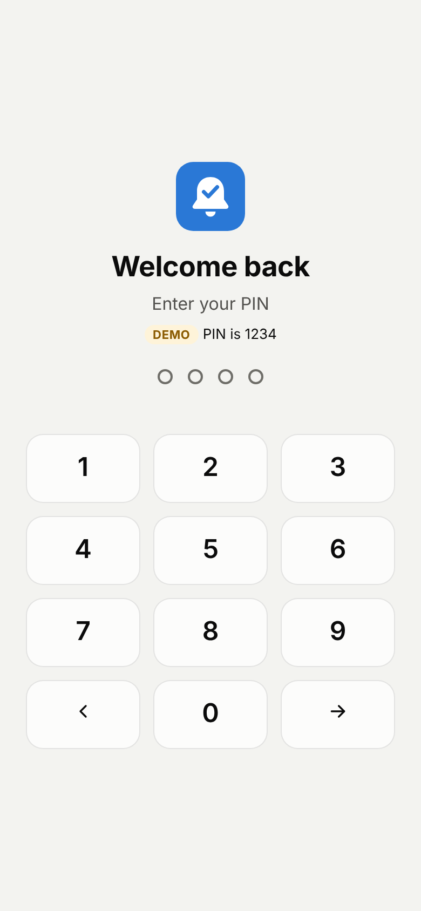

## 2. The dashboard

What needs you right now: overdue, due today, waiting on others and closed this week, then your
Top 3 and the rest of today. Further down are the follow-up radar, tasks that need a decision,
basket tiles and charts. The big mic button is always one tap away.

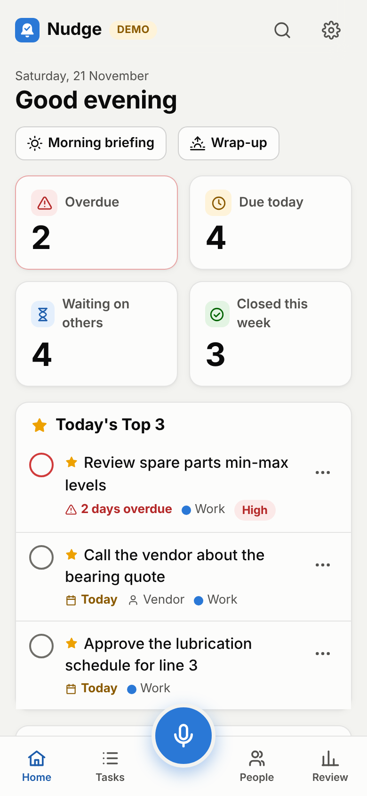

On a laptop, the same dashboard has a sidebar with the lists and baskets. Light and dark:

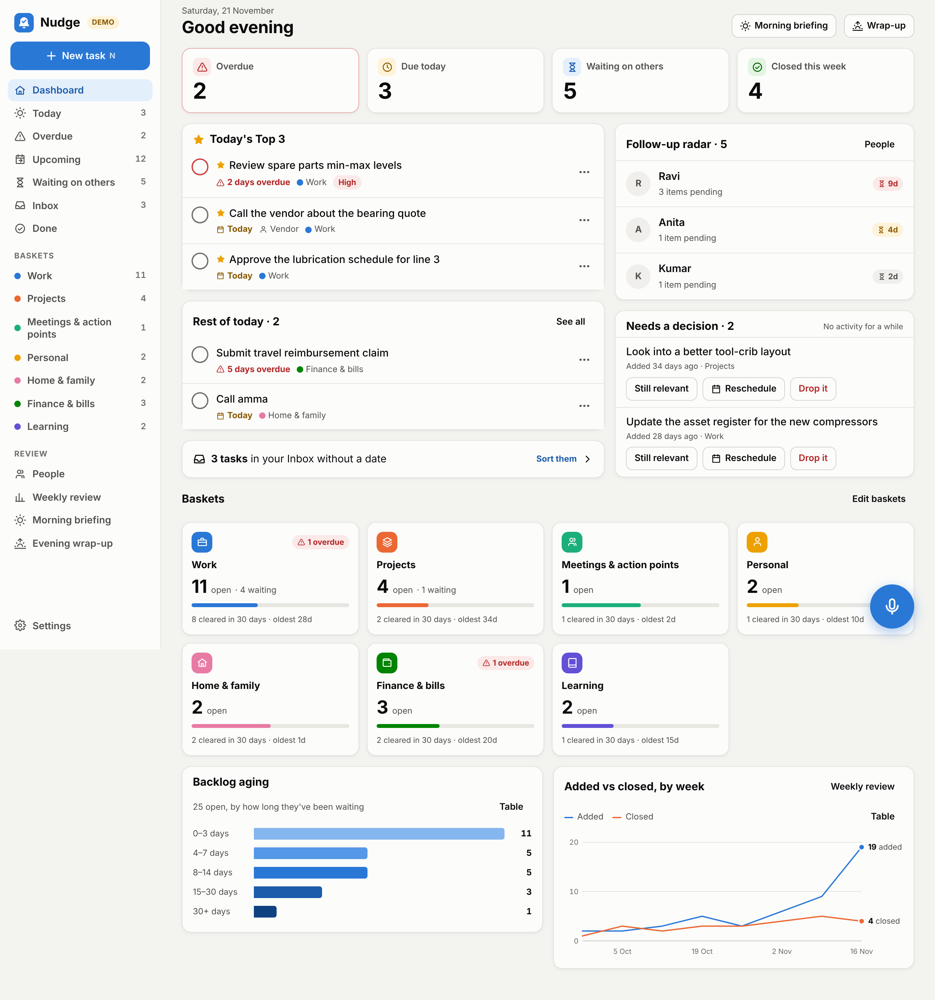
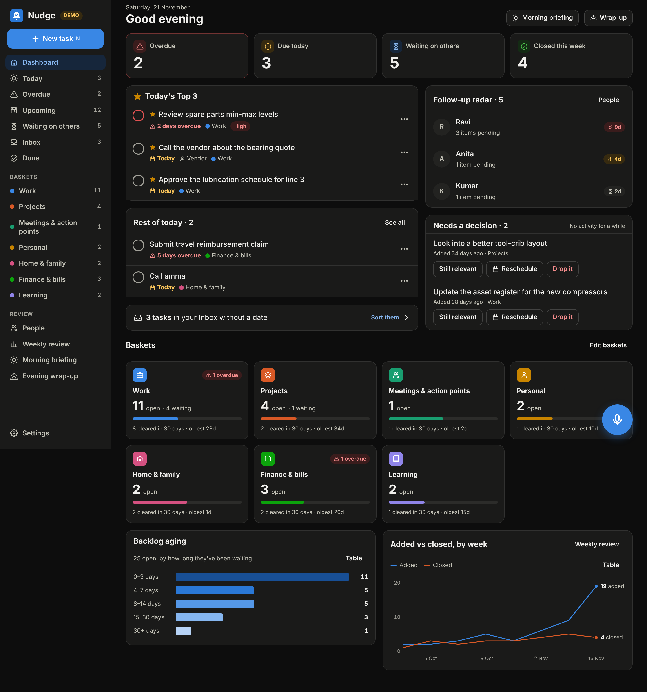

## 3. Say it

Tap the mic, or hold it and let go when you're done, then say everything at once. The bars show
it's listening.

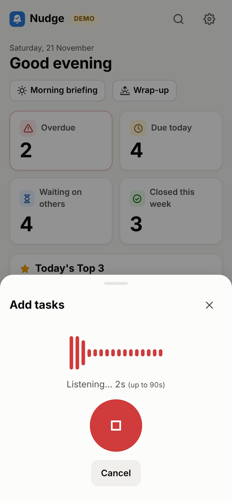

## 4. Check and save

One sentence became three tasks. Dates, times, the person and "waiting on Ravi" are filled in.
Guessed fields (here, the basket) are highlighted until you change them or save. You can edit the
words that were heard, remove a task, add notes or a checklist, or save the whole thing as one note.

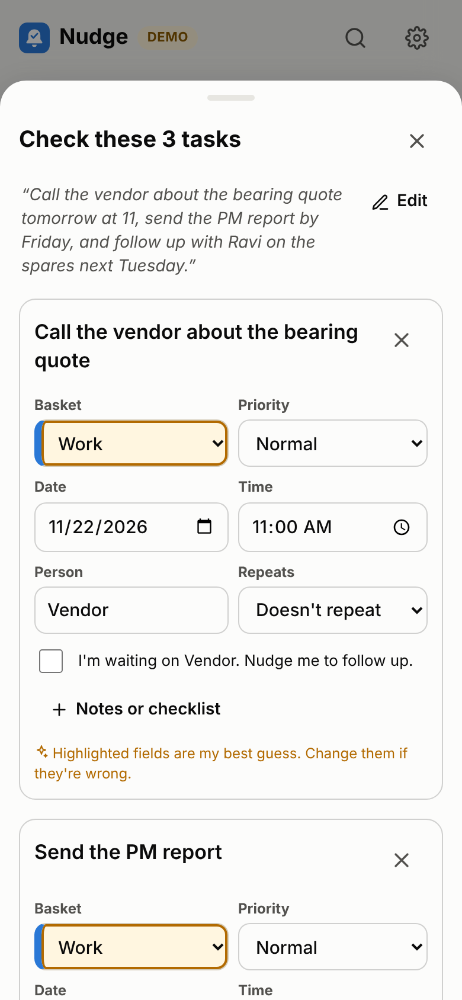

## 5. Close it in one tap

Tap the circle (or swipe right) and the task is done. The toast offers **Undo**, a follow-up in 3
days or a week, and **Add note** for the outcome, typed or spoken. Swipe left to move a task to
tomorrow.

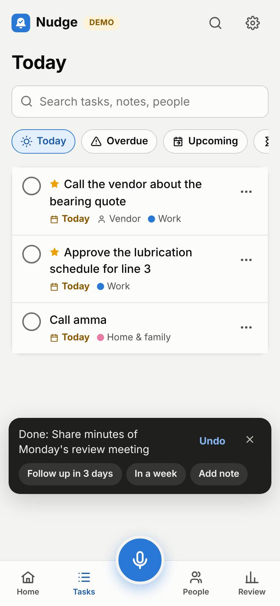

## 6. Chase people without the awkwardness

For anything you're waiting on, Nudge writes a polite follow-up you can send by WhatsApp or e-mail,
share, or copy. It gets a little firmer the longer you've waited. "I've sent it" resets the reminder clock. If there's still no reply, it nudges you
again in a few days.

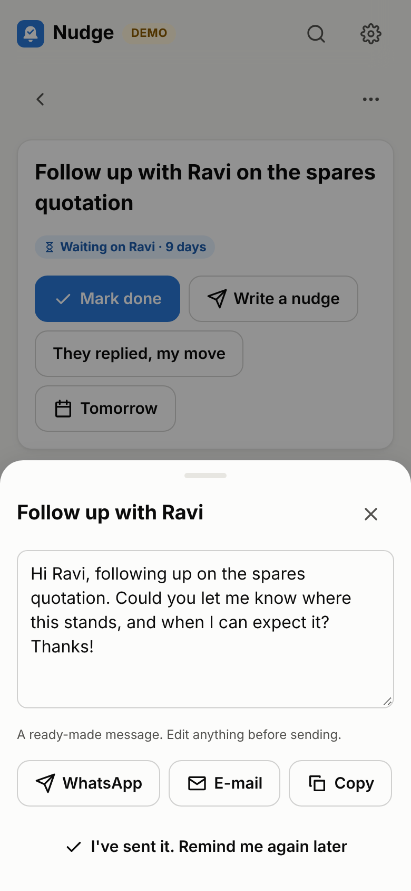

## 7. Ask

"What's pending with Ravi?" The answer is read aloud, with the matching tasks underneath. You can
also say "mark the vendor call done" or "move the PM report to Monday".

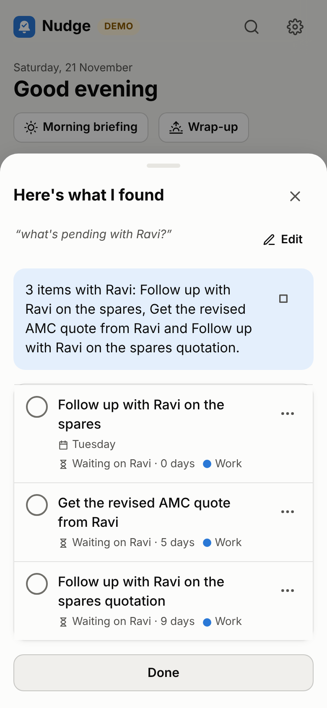

## 8. Morning briefing

Pushed to your phone at 07:30 (and e-mailed, if you set that up). Open it to see the full list, or tap **Read aloud**.

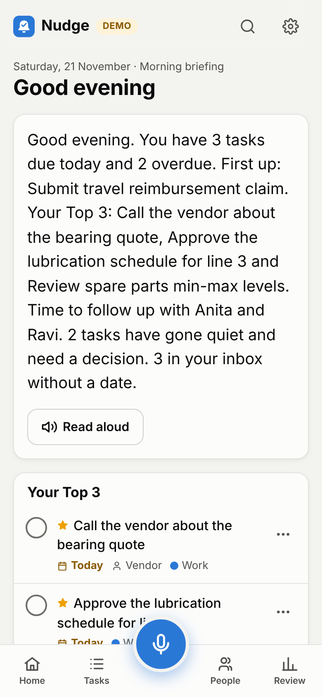

## 9. Weekly review

Closed vs added, a per-day chart, what slipped, who you've waited on longest, and what's gone
quiet. Sunday's wrap-up reminds you it's ready.

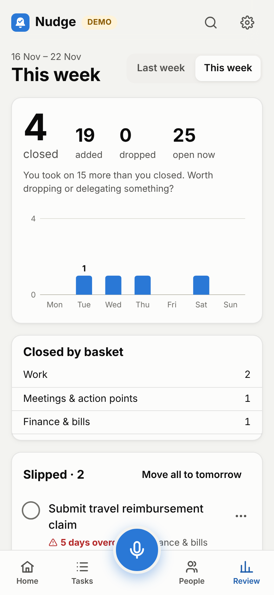

## 10. People

Everyone you have open business with, longest wait first.

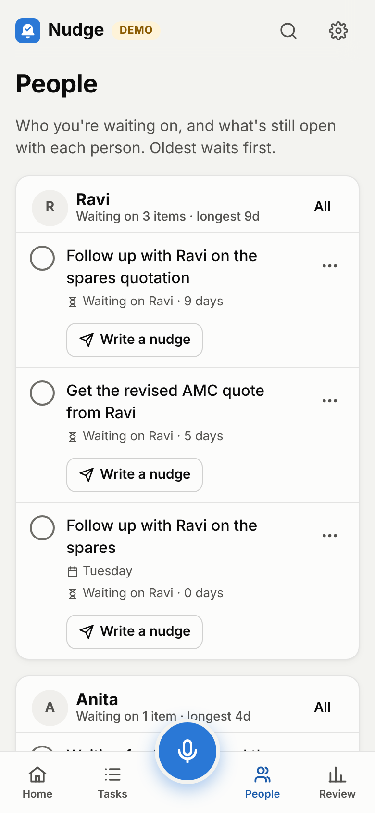

## 11. Settings

Notifications for this device, times and quiet hours, follow-up rhythm, e-mail digest, baskets,
voice status and a plain-English privacy summary, Excel export, backups, and PIN.

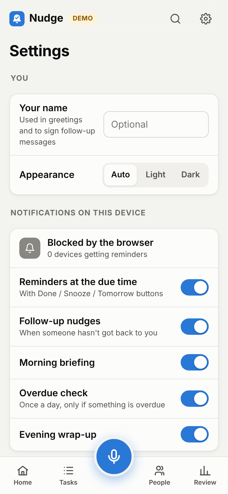

Further down, **Voice and privacy** says in plain words what (if anything) leaves your computer.

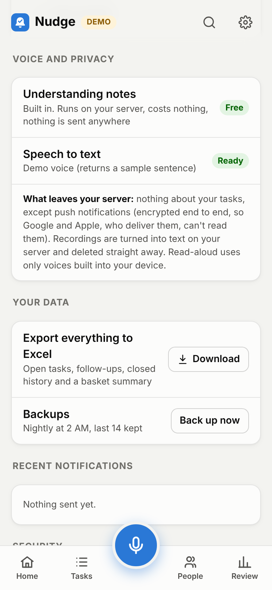
