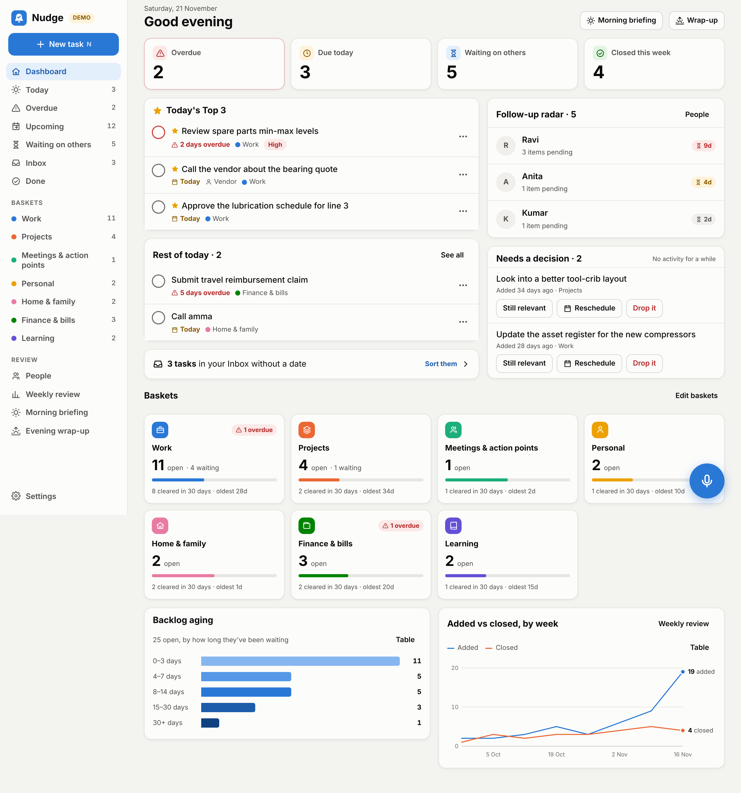

# Nudge: your voice-first task and follow-up assistant

Nudge is a personal assistant for the work that piles up: you say what's on your mind, it turns that
into tasks in colour-coded baskets, reminds you when things are due, helps you close them out, and
keeps chasing the people you're waiting on until they reply.

It's an installable web app (PWA) for your phone and laptop that runs on a computer you own.

**Free and private.** No subscriptions, API keys or accounts. Notes are understood and voice is
transcribed on your own computer, so your tasks, notes and recordings never leave it. Push
reminders are encrypted end to end on their way to your phone. See
[RUNBOOK.md § Privacy](RUNBOOK.md#10-privacy-what-leaves-your-computer) for exactly what goes where.



See [DEMO.md](DEMO.md) for a walk-through with phone screenshots, and [RUNBOOK.md](RUNBOOK.md) to set it up for real.

## Quick start (demo)

Needs Docker with Compose v2.24 or newer.

```bash
cd nudge
docker compose up -d
```

Open **https://localhost** (accept the local certificate warning) and enter PIN **1234**.

The demo has a fortnight of sample tasks and shows a **DEMO** badge. To use it for real (your own
PIN, your phone, notifications), follow [RUNBOOK.md](RUNBOOK.md).

## What it does

| Area | Features |
|---|---|
| **Voice capture** | Tap the mic (or hold to talk) and say several things at once. Each becomes its own task with title, basket, date and time, priority, person, repeat rule, notes and checklist filled in. Guessed fields are highlighted until you confirm them. You can also type. Voice commands work too: "mark the vendor call done", "move PM report to Monday", "what's pending with Ravi?" (the answer is read aloud). |
| **Baskets** | Work, Projects, Meetings & action points, Personal, Home & family, Finance & bills, Learning. Each has its own colour and icon; add, rename, recolour, reorder or delete them. |
| **Lists** | Inbox (no date yet), Today, Upcoming, Waiting on others, Overdue, Done. Search across titles, notes, people and closing notes. |
| **Dashboard** | Overdue / Due today / Waiting / Closed-this-week numbers, Today's Top 3, today's list with "move overdue to tomorrow", basket tiles (open, overdue, oldest, cleared in 30 days), follow-up radar by person, "Needs a decision" for tasks gone quiet, backlog aging, and added-vs-closed by week. |
| **Closing** | One tap (or swipe right) closes a task. The toast that follows offers Undo, "Follow up in 3 days", "In a week" and "Add note" (typed or spoken). Repeating tasks roll forward to their next date. |
| **Follow-ups** | "Waiting on" tasks track who, what and for how long, and nudge you every few days until closed. A ready-to-send follow-up message (politer at first, firmer after a long wait) goes out through WhatsApp, e-mail, the share sheet or the clipboard. "I've nudged" resets the timer. |
| **Reminders** | Push at the due time, with Done / Snooze 1h / Tomorrow buttons on the notification (they work away from home too, and sync later). Morning briefing by push (and optionally e-mail), a midday overdue check, an evening wrap-up (with the weekly review on Sundays), and quiet hours. The home-screen icon shows a badge with what's due. |
| **Reviews** | Morning briefing and evening wrap-up screens (read aloud), weekly review (closed, added, dropped, per-day chart, by basket, slipped, waiting longest, oldest, gone quiet), and a People page. |
| **Everything else** | Offline: the app opens without a connection, and quick adds, closes, snoozes and voice notes sync later. Excel export, nightly backups (last 14 kept), PIN lock with lockout, light and dark themes, keyboard shortcuts on desktop (`N` new, `V` voice, `/` search). |

## How it works

```
                         ┌──────────────── your computer ─────────────────────┐
Phone / laptop (PWA) ─HTTPS─▶ Caddy ─▶ API (FastAPI + SQLite) ─▶ Whisper (speech to text)
   mic, push, offline     │            built-in note understanding,              │
                          │            reminders, nudges, backups                │
                          └────────────────────┬─────────────────────────────────┘
                                               └─▶ encrypted push to your phone
                                                   (optional: e-mail via your mail provider)
```

- **Speech to text** runs in the bundled Whisper container (`stt/`), so recordings stay on your
  server. Recordings are transcribed in memory and never stored.
- **Understanding** is built in (`backend/app/rules.py`), with no outside AI. It splits one
  sentence into several tasks and reads dates ("tomorrow 5pm", "next Tuesday", "in 2 hours",
  "25/11", "end of the month"), repeats ("every Monday and Thursday", "on the 10th every month"),
  priority words, people, waiting-on phrases and baskets by keyword. It also handles commands, using
  your open tasks to find the right one. Anything it guessed is highlighted on the review card.
- **Reminders** come from a scheduler inside the API that checks every 30 seconds. Daily jobs run
  once, inside a 3-hour window after their time, so a restart never sends yesterday's briefing.
- **One user**: a PIN unlocks the app. Five wrong tries lock it for 5 minutes, and ten for 30.
  Notification buttons use signed, expiring tokens, so Done and Snooze work from the lock screen.

## Layout

```
nudge/
├── README.md  RUNBOOK.md  DEMO.md  docker-compose.yml  .env.example
├── backend/            FastAPI, SQLAlchemy, SQLite (Python 3.12)
│   ├── app/
│   │   ├── rules.py    built-in note understanding (dates, repeats, people, baskets, commands)
│   │   ├── understand.py      turns a note into review cards; writes follow-up messages
│   │   ├── tasks_service.py   create / close / follow-up / repeat / undo / snooze / nudge
│   │   ├── dashboard.py       dashboard, briefing, wrap-up, weekly review, people
│   │   ├── scheduler.py       reminders, nudges, digests, backups
│   │   ├── push.py  mailer.py  digest.py  excel.py  backup.py  security.py
│   │   └── routers/    HTTP API (interactive docs at /api/docs when API_DOCS=true)
│   └── tests/          80 tests (pytest), including one that fails if understanding uses the network
├── frontend/           React + Vite PWA, custom service worker (offline + push)
├── stt/                Whisper speech-to-text server (faster-whisper, OpenAI-style API)
└── docs/               screenshots and the script that captures them
```

## Development

```bash
# Backend
cd backend
python -m venv .venv && . .venv/bin/activate
pip install -r requirements-dev.txt
pytest                                    # 80 tests
SEED_SAMPLE_DATA=true STT_PROVIDER=mock uvicorn app.main:app --reload

# Frontend (proxies /api to :8000)
cd frontend
npm install
npm run dev                               # http://localhost:5173
npm run build                             # type-check + production build
```

Screenshots: with the demo running, `node docs/capture-screens.cjs http://localhost:8000`.

Admin commands (inside Docker: `docker compose exec api python -m app.cli <command>`):
`set-pin 4321`, `clear-sample`, `backup`, `tick` (run the scheduler once).

## Design notes

- Colours: basket and chart colours are a colour-blind-checked categorical palette, used in a fixed
  order. Light and dark modes each have their own validated set. Status colours (overdue red,
  due-today amber, done green) are reserved for status, and always come with an icon and a word.
- Every chart has a table view, values are never hover-only, and text never relies on colour alone.
- Tap targets are at least 44px, the base text size is 16px, and reduced motion is respected.
