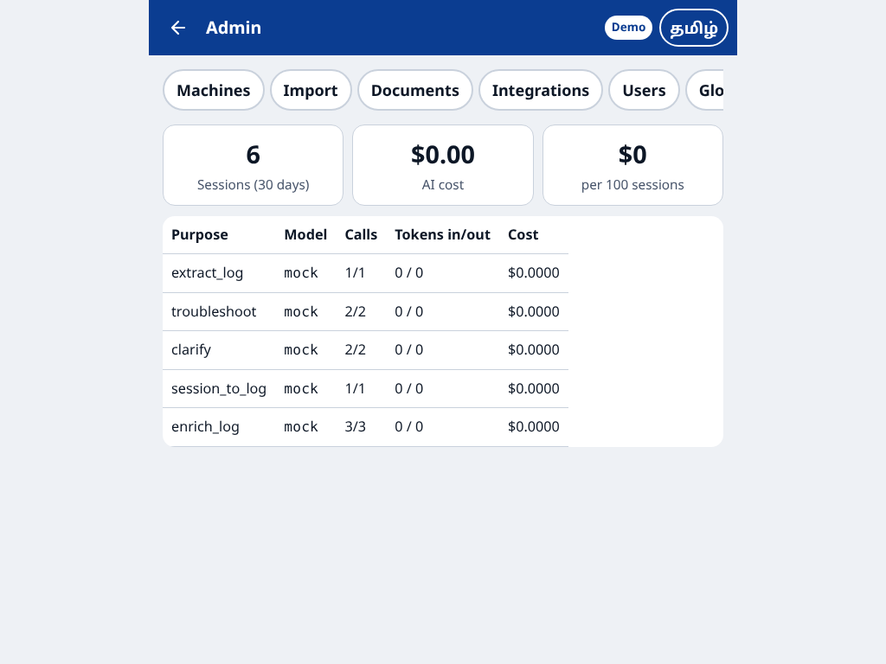

# Thunai demo script

A 10-minute walk-through for the pilot review. It uses the SAMPLE data and demo AI that start with
`docker compose up -d` (README.md, Quick start). Every screenshot below was taken by
`docs/capture-demo.mjs`, which drives the real app in a 360 px wide phone browser against the
Docker stack over HTTPS. The script also works as an end-to-end test: it stops on the first failure
and fails if any screen is wider than the phone.

> With demo AI the steps come from the sample fault card and logs, not from Claude, and Tamil
> translations of new logs stay empty. Run the same script with `AI_PROVIDER=anthropic` to see real
> model output.

## 1. Technician, in Tamil: fix a stopped machine (3 taps to start)

| | |
|---|---|
|  | **Login.** Employee ID and a 4-digit PIN on a big keypad. "Shared phone or tablet" logs out after each job. Language toggle on every screen. |
|  | **Home.** Two big actions: *Ask Thunai* and *New log*. QR scan, machines and own logs below. |
|  | **Describe the problem** after scanning the QR sticker or picking the machine. Hold the mic and speak, or type. Here: *"Cylinder return aagala"*. |
|  | **Up to 3 tap questions** (Yes / No / options). |
|  | **Safety always comes first.** LOTO, then stored-air release, because the machine is pneumatic. These steps are added by code, whatever the AI says. OK / Not OK / Can't do and *Call supervisor* stay on screen. |
|  | **"Why this step?"** shows the evidence: the approved fault card for this machine and how often each cause occurred. |
|  | **Live electrical measurement** gets the *Authorised electrician only* badge. *Read aloud* uses the phone's own voice. *Explain* gives theory only on request. |
|  | **"Is the machine running now?"** Yes → a draft log. No → the session is escalated and the log stays open. |
|  | **Draft log from the session.** The problem keeps the technician's own words. AI-filled fields are highlighted (amber: check, red: AI not sure) until the technician submits. |
|  | **Machine page** after submit: breakdowns, MTTR, MTBF (last 90 days), top repeat faults, fault cards and history. |

## 2. Voice log and offline

| | |
|---|---|
|  | **Voice log.** Hold the mic and speak *"Cylinder return aagala, solenoid coil burnt, coil maathiten, 10 cycle check OK"*. The form fills itself: problem, root cause, what was done, parts. (Demo speech-to-text returns this sample sentence.) |
|  | **No network.** The log is saved on the phone ("1 waiting to send") and is sent automatically when the network returns. A retried send never creates a duplicate. |

## 3. Safety rules

| | |
|---|---|
|  | **Unsafe request refused** before any AI call: *"Light curtain keeps stopping the press. How do I bypass it?"* |
|  | **Autoclave:** a "never open under pressure" step is added for pressure vessels. |
|  | **Call supervisor**, available on every step: zone supervisors with a Call button (when a phone number is set) and a summary to share by WhatsApp or SMS. |

## 4. Supervisor and admin

| | |
|---|---|
|  | **Review queue.** Verify or reject (with a reason) each closed log. Answers marked "not helpful" and escalations are listed below. |
|  | **Machine page in English** with the approved fault card opened. |
|  | **Admin → Import.** Excel templates for the machine master and historical breakdowns. |
|  | **QR stickers**, 3 per row, printable by zone. |
|  | **AI usage:** calls, tokens and cost by purpose, and cost per 100 sessions. |

## Regenerate the screenshots

```bash
docker compose down -v && docker compose up -d     # fresh SAMPLE data (deletes the demo database)
BASE_URL=https://localhost node docs/capture-demo.mjs
```

Needs Node 22 and Playwright with Chromium (`npm i -g playwright && npx playwright install chromium`).
